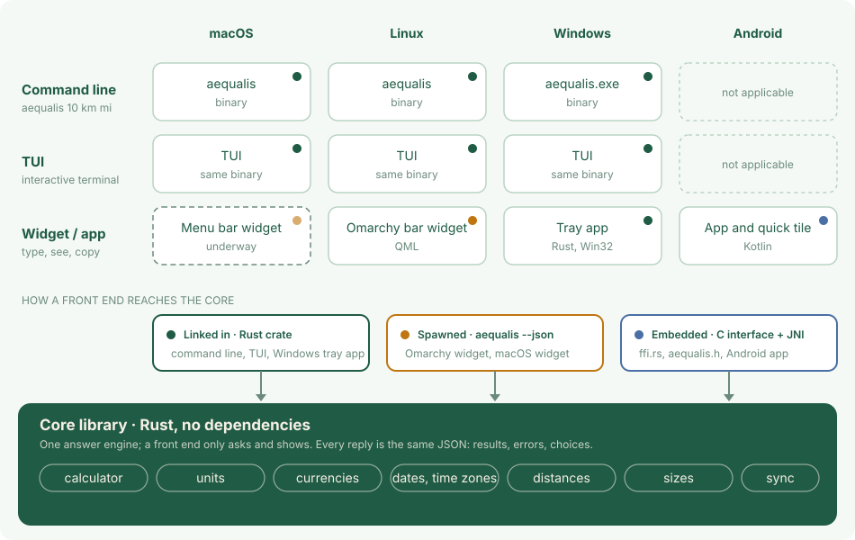

# Architecture

Aequalis is one core library in Rust and a thin front end for each place you use it. The core answers; a front end only asks and shows. So a unit, a date or a time zone is worked out the same way on a Mac, a Linux bar, Windows and a phone.

## The core library

Plain Rust with no dependencies, which keeps the binary small. It holds everything that makes up an answer: the calculator, units, currencies, dates and time zones, distances, shoe and clothes sizes, and the data sync. A request goes in as text; a reply comes out as JSON holding the results, the errors, or the choices to ask the user when a request can be read in more than one way.

## Three kinds of front end

| Kind | What it is | Where |
|---|---|---|
| Command line | `aequalis 10 km mi`, `--shell` for a prompt, `--json` for programs | macOS, Linux, Windows |
| TUI | the interactive terminal mode, the same binary with no arguments | macOS, Linux, Windows |
| Widget or app | a small window you type in, then copy the answer | Linux (Omarchy bar widget), Windows (tray app), Android (app and quick tile); macOS is underway |

## How a front end reaches the core

> [!note] Three bindings, one core
> Which one a front end uses depends on what its platform can do.

- **Linked in.** The command line, the TUI and the Windows tray app use the library as a Rust crate.
- **Spawned.** The Omarchy widget is QML: it runs `aequalis --json` on each keystroke and shows the reply. The macOS widget will do the same.
- **Embedded.** The Android app is Kotlin. It loads the core as a shared library through a C interface (`ffi.rs`, `aequalis.h`) with a small JNI bridge, and has the downloader of the app plugged in, since an app cannot start `curl`.

## Speed and memory

Small and quick, because the core does everything in memory with no runtime to start. Measured on a laptop with an 11th Gen Intel Core i7-1185G7 (Linux, release build, the binary is 1.8 MB). Each request is a new process, which is how the widget uses it; it includes starting the program, reading the settings and the answer.

| Request | Time to reply (median of 60) | Memory (peak) |
|---|---|---|
| `12+12/3` | 3.4 ms | 13.5 MB |
| `10 km mi` | 4.0 ms | 13.5 MB |
| `12 usd eur` | 2.8 ms | 13.5 MB |
| `44 it us` (shoes and clothes) | 3.3 ms | 13.5 MB |
| `18E6 unix` | 3.1 ms | 13.5 MB |
| `10:00AM Paris to New York` | 3.7 ms | 13.5 MB |
| `now Rome Tokyo` | 3.5 ms | 13.6 MB |
| `Italy Japan` (distance) | 3.3 ms | 13.6 MB |

In a prompt (`aequalis --shell`) or in an app, the program is already running, so a request is only the work itself: 1,000 mixed requests took 112 ms in total, about **0.1 ms each**, with the memory staying at 13.6 MB.
